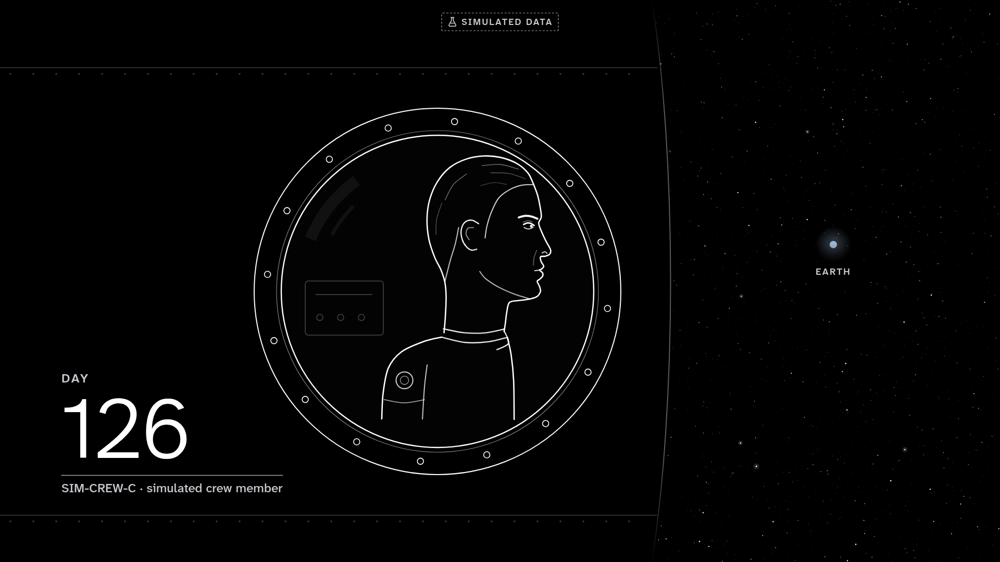

# Monitoreo ocular de astronautas

[English](README.md)

Prototipo web para el desafío **Create Health Monitoring Software for Astronauts
on Space Missions** de NASA Space Apps Challenge 2026. Ayuda al tripulante a entender
cambios asociados al síndrome neuro-ocular del vuelo espacial (SANS), compararlos
con su propio examen de antes del vuelo y preparar la conversación con el médico.

**Datos simulados. No es un dispositivo médico. No está validado con personas.**

El instrumento virtual genera tomografías retinales ficticias en un formato `.vol`
modelado a partir de las exportaciones de Spectralis. Un motor determinista mide
las imágenes localmente. El resultado muestra cambios, incertidumbre provisoria,
umbrales publicados y un próximo control propuesto. Un asistente de IA opcional
explica resultados con una base de conocimiento citada y un alcance acotado.

## Ver el video de 30 segundos

[](monitoreo-salud-astronautas/video-demo/entrega/lynceus-demo-final-subtitulos-es.mp4)

- **[Video demo con subtítulos en español](monitoreo-salud-astronautas/video-demo/entrega/lynceus-demo-final-subtitulos-es.mp4)**: narrado en inglés y subtitulado en español.
- **[Video demo en inglés](monitoreo-salud-astronautas/video-demo/entrega/lynceus-demo-final.mp4)**: el mismo video, sin subtítulos.

Cada video dura 30 segundos. Si no se reproduce en el navegador, se puede descargar
desde la página del archivo. Las cifras de la tomografía salen del motor de análisis
sobre un control simulado; las [notas del video](monitoreo-salud-astronautas/video-demo/decisiones.md) indican la fuente de cada número.

## Probar la demo

**[Abrir la demo pública](https://lynceus-sans.vercel.app)** — no requiere una cuenta.

Requiere **Node.js 22 o posterior** y **pnpm 10.18.3**. Desde la raíz del repositorio:

```sh
pnpm install
pnpm dev
```

Abrí la dirección que imprime Vite, normalmente http://localhost:5173/.
Elegí **Elena Voss, día de vuelo 150** y empezá el control. La captura del ojo
izquierdo tiene un fallo guionado y un segundo intento utilizable.

Seguí la [guía breve de demo](docs/es/demo.md). El análisis de imágenes, resultado,
historia e informe funcionan sin clave. El asistente requiere una clave de Anthropic
en el servidor y conexión; ver [desarrollo](docs/es/development.md).

## Qué está implementado

- Cuatro tripulantes ficticios en una misión de 180 días.
- Agudeza de cerca, Amsler y síntomas, con registro explícito de pruebas salteadas.
- Captura OCT simulada en vivo, rechazos por calidad, reintentos y visor.
- Mediciones contra la referencia de cada ojo, gráficos de resultado e historia.
- Informe descargable para la conferencia médica y preguntas para el médico.
- Interfaz en español e inglés, información citada del cerebro y asistente opcional.

La evaluación sintética abarca **621 capturas de ocho ojos virtuales**, incluidas
16 capturas de referencia. Su modelo ajustado no cumplió los criterios de activación.
La aplicación conserva el **modelo de error provisorio**. No son resultados de
precisión clínica; ver [evidencia y límites](docs/es/evidence.md).

La demo pública se desplegó el 15 de noviembre de 2026. Haiku 5.5 pasó seis
comprobaciones contra el proveedor real, una consulta en la interfaz local y otra
en producción; ver [resultados y observación de redacción](docs/es/development.md).
El motor de imágenes es determinista; las respuestas del modelo de lenguaje pueden variar.

## Documentación

| Documento | Para qué sirve |
|---|---|
| [Producto](docs/es/product.md) | Usuario, recorrido y significado del resultado |
| [Demo](docs/es/demo.md) | Una presentación breve y reproducible |
| [Evidencia](docs/es/evidence.md) | Fuentes, umbrales, evaluación y límites |
| [Supuestos](docs/assumptions.md) | Registro único bilingüe de decisiones del proyecto |
| [Desarrollo](docs/es/development.md) | Preparación, arquitectura, comprobaciones y asistente |
| [Guía personal para defender el proyecto](monitoreo-salud-astronautas/guia-para-defender-el-proyecto.md) | Cómo explicar modelos, gráficos y resultados |

Las [investigaciones](monitoreo-salud-astronautas/investigaciones/) y
[especificaciones](monitoreo-salud-astronautas/especificaciones/) conservan el
trabajo de respaldo. El nombre del producto se define en
[`packages/core/src/product.ts`](packages/core/src/product.ts).

## Datos y límites

Los controles se guardan en el navegador. Para preguntar al asistente se solicita
consentimiento: la pregunta y un resumen numérico sin identidad del tripulante
salen hacia Anthropic a través del servidor. No se incluyen imágenes OCT. El texto
libre puede contener información que escriba el visitante; el asistente no es un
canal anónimo para datos de pacientes reales.

El prototipo no diagnostica SANS, indica medicación ni infiere la presión dentro
del cráneo a partir del ojo. El médico de vuelo conserva la decisión.
