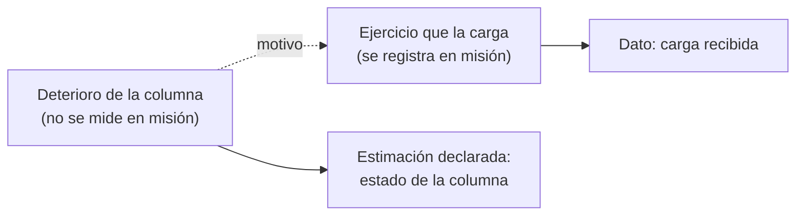

# Enfoque: la columna a través del ejercicio

> **Estado:** enfoque de trabajo, elegido para profundizar. Qué hace la herramienta todavía no está definido.

| | |
|---|---|
| **Hackatón** | NASA Space Apps Challenge 2026 — 14 y 15 de noviembre de 2026 |
| **Desafío** | *Create Health Monitoring Software for Astronauts on Space Missions* — [página oficial](https://www.spaceappschallenge.org/2026/challenges/health-monitoring-software/) |
| **Fecha** | 14 de noviembre de 2026 |
| **Para qué es** | Dejar claro el enfoque del proyecto: qué problema se mira, desde dónde, qué se puede afirmar y qué no. |
| **Qué no es** | No es el diseño de la solución ni una lista de funcionalidades. Tampoco entra en detalle técnico; eso viene después. |
| **De dónde sale** | De la discusión entre Ramiro y el asistente de IA (Devin) sobre la investigación `investigaciones/herramientas-medicion-columna-v2.md` (rama `investigaciones`, commit `7c7c87c`). El tema, el momento y los criterios los definió Ramiro; el giro hacia el ejercicio lo propuso el asistente a partir de la evidencia. Documento redactado por el asistente. |
| **Documentos relacionados** | [decisiones-y-criterios.md](decisiones-y-criterios.md) · [recursos-del-desafio.md](recursos-del-desafio.md) |

### Cómo leerlo

- **Secciones 1 y 2:** el enfoque y el problema que lo motiva.
- **Secciones 3 y 4:** qué es dato, qué es estimación y dónde entra la columna.
- **Secciones 5 y 6:** qué lo respalda y cuáles son sus límites.
- **Secciones 7 a 9:** cómo cumple los criterios acordados, qué queda afuera y qué falta.
- Los códigos entre paréntesis (N11, P4, O2…) son las fuentes de la investigación v2. Lo marcado **"a verificar"** todavía no tiene fuente leída.

---

## 1. El enfoque en pocas palabras

**En lugar de buscar datos que vengan de la columna, se miran los datos del ejercicio que la protege.**

- El astronauta genera los datos con su ejercicio diario.
- Esos datos dicen **cuánta carga está recibiendo la columna**, es decir, cuánta protección.
- **No dicen cómo está la columna.** Ese estado sigue siendo una estimación, y se comunica como tal.

## 2. El problema que lo motiva

Durante una misión larga la columna se deteriora de forma silenciosa. El problema es que **ese deterioro no se puede medir en misión**: todo lo que se sabe sale de estudios hechos en Tierra, antes y después del vuelo.

| Qué cambia | Cuánto | Cómo se midió | Fuente |
|---|---|---|---|
| Densidad ósea de la columna lumbar | −0,47 % a −0,68 % por mes | Rayos X, antes y después (9 y 10 astronautas) | N11 |
| Parte magra de los músculos lumbares | 86 % → 72 % | Resonancia, antes y después (6 astronautas) | P4 |
| Curva lumbar | 41,9° → 37,2° | Resonancia, antes y después (6 astronautas) | P5 |
| Movilidad entre las vértebras L4 y L5 | −30 % | Rayos X en movimiento, antes y después (6 astronautas) | P5 |

En la estación no hay equipo para medir densidad ósea en personas, y la curvatura y la movilidad no se miden en vuelo.

## 3. Qué es dato y qué es estimación

| Qué | Tipo | Cómo se obtiene en misión | Fuente |
|---|---|---|---|
| Ejercicio en cinta y bicicleta | **Dato**, registrado por la máquina | Archivos de pulso y carga, que se bajan una vez por semana | P18, N9 |
| Ejercicio de fuerza: carga, series y repeticiones | **Dato**, anotado por el astronauta | Lo carga el astronauta en una computadora (dato de 2016) | P18 |
| Fuerza de cuerpo entero | **Dato**, medición directa | Prueba de tirón, cerca del día 30 y unos 30 días antes de volver | P14 |
| Carga que llega a la columna | **Estimación** | Se calcula con modelos | P8, N8 |
| Estado de la columna (hueso, músculos, curvatura) | **Estimación** | No se mide en misión; solo se puede proyectar con promedios de grupo | N11, O1 |

## 4. Dónde entra la columna

El ejercicio abarca todo el cuerpo. La columna es el foco en **la parte del ejercicio que la carga a lo largo**.

| Ejercicio | Relación con la columna | Respaldo |
|---|---|---|
| Máquina de fuerza: peso muerto y sentadilla | La más directa. Con esta máquina la pérdida de hueso lumbar es menor | Evidencia leída (N11). Que estos ejercicios carguen la columna: **a verificar** |
| Cinta con arnés | El arnés aplica entre 70 % y 80 % del peso corporal mientras se corre | Porcentaje leído (P18). Que esa carga pase por la columna: **a verificar** |
| Bicicleta | Poca: sirve más al corazón que a la columna | **A verificar** |

## 5. Qué lo respalda

- **El ejercicio de fuerza protege al hueso de la columna, aunque no del todo:** −0,68 % por mes sin la máquina de fuerza actual y −0,47 % con ella (N11).
- **Es lo único de la columna que se registra de rutina y durante toda la misión:** alrededor de 1,5 horas por día, 6 a 7 días por semana (O2, P18).
- **Hay una medición directa del resultado en misión:** la prueba de fuerza de cuerpo entero, dos veces por misión (P14).
- **Está en los recursos oficiales del desafío:** los riesgos de huesos y de estado físico presentan el ejercicio como la contramedida (O1, O2).
- **Hay valores reales para armar datos plausibles:** medianas de 46 astronautas, peso muerto 192 libras, sentadilla 181 y elevación de talones 239 (P20).

## 6. Límites y puntos débiles

| Límite | Por qué importa |
|---|---|
| **Hacer ejercicio no equivale a tener la columna protegida.** Los músculos de la espalda se deterioran igual en tripulaciones que se ejercitan a diario. | Es una inferencia a partir de dos datos de la investigación, no una afirmación de las fuentes. Solo se puede afirmar si el astronauta cumplió la contramedida, no que su columna esté bien. |
| **Los porcentajes son promedios de grupo**, de 6 a 17 personas. | No dicen el valor de un astronauta en un día dado. |
| **La carga que llega a la columna se estima.** El sensor de fuerza de la máquina no grababa desde 2011 (dato de 2014). | El dato real es lo que se hizo en la máquina, no lo que recibió la columna. |
| **La carga puede ser protección y riesgo a la vez.** Una revisión plantea que cargar una columna debilitada podría aumentar el riesgo de lesión, o ser beneficioso (P1). | Es una hipótesis abierta, no un hecho. |
| **Datos viejos:** la anotación manual en la máquina de fuerza es de 2016. | Puede haber cambiado. |
| **Las naves futuras serán más chicas** y podrían no llevar cinta (O6, N5). | Cambia qué ejercicio habría disponible fuera de la estación. |

## 7. Cómo cumple los criterios acordados

| Criterio (ver decisiones-y-criterios.md) | Cómo lo cumple |
|---|---|
| C2 — Comunicación clara y responsable | "Esto es lo que hiciste" es un dato que el astronauta entiende y puede verificar. |
| C3 — Directo, preciso y con significado claro | El ejercicio se registra de rutina y su significado como contramedida está respaldado. |
| C4 y C6 — La incertidumbre se dice; medido y estimado se distinguen | El estado de la columna se presenta siempre como estimación, separado del dato. |
| C5 y C12 — Balance con el tiempo; pocos indicadores | Se apoya en pocas señales, todas con fuente leída. |
| C10 — Datos ficticios plausibles | Hay medianas, frecuencias y unidades reales para simular. |
| D4 — Durante la misión | Todo lo que se usa como dato se genera en misión. |

## 8. Qué queda afuera

- La ecografía de discos, los análisis de sangre (el resultado no está disponible en misión), la curvatura y la movilidad.
- Lo que pasa al volver a la Tierra.
- El dolor de adaptación de los primeros 12 días: es lo mejor documentado y podría ser un complemento del inicio de la misión, pero no está decidido.

## 9. Qué falta

1. Verificar lo marcado "a verificar" en la sección 4.
2. Investigar cuánto protege el ejercicio a la columna en particular, sobre todo a los músculos.
3. Definir la solución: qué hace la herramienta con estos datos. Lo define Ramiro.
4. Definir los umbrales: cuándo algo amerita un aviso y cuándo se deriva a la tripulación o a los médicos en Tierra.
5. Recién después, entrar en el detalle técnico.
