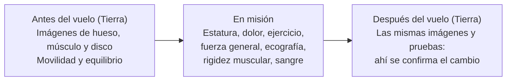

# Herramientas de medición de la columna vertebral en misión espacial (v2)

| | |
|---|---|
| **Hackatón** | NASA Space Apps Challenge 2026 — 14 y 15 de noviembre de 2026 |
| **Desafío** | *Create Health Monitoring Software for Astronauts on Space Missions* — [página oficial](https://www.spaceappschallenge.org/2026/challenges/health-monitoring-software/) |
| **Fecha** | 14 de noviembre de 2026 |
| **Versión** | **Segunda versión.** Cambia respecto de la primera en que las fuentes se leyeron en texto completo y cada cifra se verificó en la fuente. Las correcciones están en la sección 6. La primera versión queda sin tocar en `herramientas-medicion-columna.md`. |
| **Para qué es** | Saber, por cada aspecto de la columna, **qué se puede medir durante la misión, con qué y con cuánto respaldo**. |
| **Qué no es** | No propone ideas ni soluciones. Es un relevamiento. |
| **Fuente** | Recursos oficiales del desafío (NASA HRP), otros reportes de NASA, otras agencias y artículos científicos. Lista completa en la sección 8. |

### Cómo leerlo

- **Sección 1:** el resultado central, en una tabla.
- **Sección 2:** una tabla corta por aspecto.
- **Sección 3:** valores de referencia (unidad, rango, frecuencia).
- **Secciones 4 y 5:** síntesis, y qué es dato y qué es supuesto.
- **Sección 6:** qué cambió respecto de la v1.
- **Secciones 7 y 8:** lo no verificado y las fuentes.

**Categorías** (se usan igual en todo el documento):

| Categoría | Significado |
|---|---|
| Directa | El instrumento mide la magnitud misma. |
| Indirecta | Mide otra cosa relacionada, de la que se infiere el estado. |
| Estimación | Valor calculado con un modelo o una proyección, sin medirlo en misión. |
| Autorreporte | Lo declara el propio astronauta. |

**Disponibilidad:** *A bordo (rutina)* = se usa habitualmente en la estación · *A bordo (estudio)* = se usó en vuelo solo como investigación · *Solo Tierra* = antes y después del vuelo.

**Fuentes:** `O` = recurso oficial del desafío · `N` = NASA, fuera de los recursos oficiales · `A` = otra agencia u organismo · `P` = artículo científico. Un **asterisco** (`P2*`) indica que **no pude conseguir el texto completo**: esas cifras figuran como "solo resumen, sin verificar" y nunca como dato principal.

---

## 1. Resultado central: qué se puede medir en misión

**Respaldo** es un criterio mío, no de las fuentes: **Alto** = uso habitual en vuelo o muchos tripulantes · **Medio** = usado en vuelo en estudios de 12 personas o menos · **Bajo** = en misión solo se infiere o se proyecta · **Nulo** = no encontré medición en misión.

| Aspecto | ¿Se mide en misión? | Con qué | Categoría | Respaldo |
|---|---|---|---|---|
| 1. Densidad ósea de las vértebras | **No** | Marcadores en sangre y proyección con tasa promedio | Indirecta / Estimación | Bajo |
| 2. Músculos: tamaño y calidad | **No** (para la espalda) | Rigidez del músculo con sensor de mano | Indirecta | Medio |
| 2. Músculos: fuerza | **Sí**, de cuerpo entero | Prueba de tirón sobre la máquina de fuerza | Directa (cuerpo), Indirecta (espalda) | Medio |
| 3. Discos | **Parcial** | Ecografía: altura y ángulo del disco | Directa, poco precisa | Medio |
| 4. Curvaturas | **No** | Ángulo entre vértebras por ecografía | Indirecta | Bajo |
| 5. Largo y estatura | **Sí** | Fotos con marcas, cinta, marca en la pared | Directa | Alto |
| 6. Movilidad | **No encontrado** | — | — | Nulo |
| 7. Dolor y rigidez | **Sí** | Reporte al médico, cuestionario | Autorreporte | Alto |
| 8. Control postural | **No encontrado** (para el tronco) | — | — | Nulo |
| 9. Carga recibida | **Sí** | Archivos de la cinta y la bicicleta; anotación del astronauta en la máquina de fuerza | Directa / Autorreporte; Estimación (columna) | Alto |
| 10. Marcadores en sangre y orina | **La muestra sí, el resultado no** | Sangre congelada, analizada al volver | Indirecta | Alto (toma) |

> **Dato clave:** en la estación no hay equipo para medir densidad ósea en personas: el densitómetro de a bordo se usa solo con roedores (N17). El ecógrafo figura como único equipo de imágenes en dos resúmenes de 2018 (P2*, P3*); una fuente leída de 2024 confirma que los rayos X para personas todavía estaban por probarse en la estación (P19).

---

## 2. Detalle por aspecto

### 2.1 Densidad ósea de las vértebras

| Método | Categoría | Disponibilidad | Dato clave y límite | Fuente |
|---|---|---|---|---|
| **DXA** (rayos X de doble energía; da densidad por área) | Directa | Solo Tierra. NASA: 4 veces antes del vuelo, y 5 y 30 días después | Columna lumbar: **−0,68 % por mes** sin la máquina de fuerza actual (9 astronautas) y **−0,47 % por mes** con ella (10 astronautas). No separa hueso compacto de esponjoso | N5, N11 |
| **QCT** (tomografía que da densidad en 3D) | Directa | Solo Tierra (estudios) | Vértebra lumbar L1: **−1,0 % por mes** (17 tripulantes, datos de 2000 a 2006) | P8, O5 |
| Resistencia de la vértebra calculada sobre la tomografía | Estimación | Solo Tierra | **−6,1 %** en ~6 meses (17 tripulantes); seguía baja hasta 4 años después y no acompaña al cambio de DXA | P8 |
| Proyección con la tasa promedio (1 % a 1,5 % por mes) | Estimación | Aplicable en misión | Es un promedio de grupo. No hay datos que validen un porcentaje de pérdida como predictor de fractura | O1, N11 |

### 2.2 Músculos de la espalda y del tronco

| Método | Categoría | Disponibilidad | Dato clave y límite | Fuente |
|---|---|---|---|---|
| **Resonancia (MRI)**: área y proporción de músculo sin grasa | Directa | Solo Tierra (6 astronautas; estudio ampliado a 12) | Músculos lumbares: parte magra **86 % → 72 %**, y 81 % a los 46 días. Multífido (músculo profundo que estabiliza la columna): 80 % → 73 % | P4, P5, N5 |
| **Tomografía**: área y densidad del músculo | Directa | Solo Tierra | Área −4,6 % a −8,4 % y densidad −5,9 % a −8,8 % (17 tripulantes) | P7 |
| **Ecografía** de músculos del tronco | Directa | Solo Tierra (ESA, día 1, 8 y 15 tras volver). En vuelo se validó solo para piernas (11 astronautas) | Multífido −6 % a −13 % entre L3 y L5 (5 astronautas, 7 misiones) | P16, P17 |
| **Myoton** (sensor de mano: da un golpecito y mide cómo vibra el tejido) | Indirecta | A bordo (estudio 2018–2023, 12 astronautas). Lo opera un compañero; 4 sesiones por misión | Rigidez del multífido lumbar: **sin cambio estadístico claro**. Solo llega a tejido superficial | P13 |
| **Tirón isométrico** sobre la máquina de fuerza (ARED) | Directa (cuerpo entero), Indirecta (espalda) | A bordo (Standard Measures): cerca del día 30 y unos 30 días antes de volver | Fuerza máxima de todo el cuerpo, en newtons. Pérdida promedio de fuerza: **10 % a 12 %** | P14, O4, O2 |

### 2.3 Discos intervertebrales

| Método | Categoría | Disponibilidad | Dato clave y límite | Fuente |
|---|---|---|---|---|
| **Resonancia**: altura y contenido de agua | Directa | Solo Tierra | Tras 6 meses, **sin cambios consistentes** en altura (cambios promedio de 0,8 mm o menos) ni en agua | P4, P5 |
| **Ecografía de columna en vuelo**: altura y ángulo del disco | Directa, poco precisa | A bordo (estudio, **7 astronautas**). La hace un astronauta sin experiencia con guía remota; 2 o 3 veces por misión; menos de 60 min | Imágenes de buena calidad, útiles para descartar anomalías importantes. **Sin cambios apreciables de altura de disco** según el reporte del proyecto; el taller de 2018 habla de una tendencia a más altura en la zona lumbar y menos en el cuello. Imágenes difíciles de obtener y algunas con poca resolución | N5, N12, N1 |

- **Solo resumen, sin verificar (P2*, P3*):** 92,5 % de imágenes útiles; coincidencia con la resonancia buena en la zona lumbar (r² = 0,83) y mala en el cuello (r² = 0,26).

> **Para no sobreafirmar:** la NASA dejó **inactiva** la preocupación por daño de disco. La vigilancia posterior al vuelo no confirmó más daño atribuible al vuelo, y las hernias parecen ligadas a factores previos (N2). La hidratación del disco no se mide en vuelo.

### 2.4 Curvaturas y alineación

| Método | Categoría | Disponibilidad | Dato clave y límite | Fuente |
|---|---|---|---|---|
| **Resonancia** acostado | Directa | Solo Tierra | Curva lumbar: **41,9° → 37,2°** (−11 %, 6 astronautas) | P5 |
| Ecografía: ángulo entre dos vértebras | Indirecta | A bordo (estudio) | Se vieron cambios de ángulo y curvatura en vuelo, sin cifra en lo leído. No da la curva completa | N12 |
| Video de postura relajada | Indirecta | A bordo (estudio) | Mide ángulos de las articulaciones del cuerpo, no de la columna | N7, N15 |

### 2.5 Largo de la columna y estatura

| Método | Categoría | Disponibilidad | Dato clave y límite | Fuente |
|---|---|---|---|---|
| Marca en la pared del módulo, con ayuda de un compañero | Directa | A bordo (rutina), solo antes de una caminata espacial | Fuera de ese caso, no se medía de rutina (dato de 2018) | P1 |
| **Fotos con marcas en el cuerpo + cinta métrica** | Directa | A bordo (estudio, 9 astronautas); días 15, 80 y unos 15 antes de volver | **+2,9 cm** al día 15 y después se estabiliza; hasta 3 %. Resultados preliminares. Varía según dónde se pone la marca, la postura y la cámara | N7, N15 |
| Regla acoplada al asiento (altura sentado) | Directa | En vuelo (estudio terminado, en el transbordador; **29 tripulantes**) | Altura sentado: **hasta 6 %**. De pie: hasta 3 % | N13, N14, N5 |
| Medición de estatura del estudio SkinSuit (ESA) | Directa | A bordo (estudio, 1 astronauta). Protocolo previsto: dos veces por día, días 2 a 7 | Buena repetibilidad dentro de una misma sesión, sin cifra | A1, P1 |

> **Dato clave:** es el **único aspecto de estructura con medición directa en misión**. La estatura puede aumentar hasta un 3 % (O1).

### 2.6 Movilidad y flexibilidad

| Método | Categoría | Disponibilidad | Dato clave y límite | Fuente |
|---|---|---|---|---|
| **Fluoroscopía** (rayos X en video mientras la persona se mueve) | Directa | Solo Tierra (6 astronautas) | Flexión y extensión L4–L5: **8,9° → 6,3°** (−30 %). Error de ±1,5° a ±2,2° | P5 |
| Evaluación física con especialista (incluye flexibilidad) | Directa | Solo Tierra; 60 días antes, y 5 a 30 días después | Prueba concreta no encontrada | N5 |

No encontré ninguna medición de movilidad de la columna hecha en misión.

### 2.7 Dolor y rigidez

| Método | Categoría | Disponibilidad | Dato clave y límite | Fuente |
|---|---|---|---|---|
| **Reporte al médico de vuelo** en conferencia médica privada | Autorreporte | A bordo (rutina) | **52 %** tuvo dolor de espalda al adaptarse (382 de 728). Leve en el 86 %. Pico el día 2, nada después del día 12. Límite: reticencia a reportar | N16, N4, N6 |
| Cuestionario estandarizado de dolor de espalda | Autorreporte | Usado solo en misiones del transbordador | Escala, ítems y momento de aplicación no encontrados en lo leído | N16 |
| Rigidez del tejido con Myoton | Indirecta | A bordo (estudio) | Mide rigidez mecánica del músculo, **no la rigidez que siente la persona** | P13 |

- **Solo resumen, sin verificar (P12*):** cuestionario diario en misiones de 15 días (20 astronautas): incidencia 70 %, intensidad media 3 de 10.
- La causa del dolor en vuelo sigue sin conocerse (N5).

### 2.8 Control postural

| Método | Categoría | Disponibilidad | Dato clave y límite | Fuente |
|---|---|---|---|---|
| Pruebas de pararse, caminar en línea y levantarse del piso, con sensores de movimiento | Directa | Solo Tierra; antes, y el día 0, 1 y ~9 después | Los déficits duran hasta una semana tras aterrizar | P14 |
| Pruebas de movimiento de cabeza, ojos y cuerpo (CIPHER) | Indirecta | A bordo (estudio) | Detalle no encontrado | O3 |

No encontré medición del control postural del tronco hecha en misión.

### 2.9 Carga recibida: ejercicio y actividad

| Método | Categoría | Disponibilidad | Dato clave y límite | Fuente |
|---|---|---|---|---|
| **Cinta (T2) y bicicleta (CEVIS)** | Directa | A bordo (rutina). Los archivos de pulso y carga se bajan una vez por semana | ~1,5 h de ejercicio real por día. Arnés de la cinta: se empieza al 60 % del peso y la mayoría queda en 70–80 % | P18, P20, N9, O2 |
| **Máquina de fuerza (ARED)** | Autorreporte | A bordo (rutina) | Repeticiones, series y carga **las anota el astronauta** en una computadora (dato de 2016; había un sistema automático previsto). Llega a 272 kg | P18, N8 |
| Carga real sobre la columna | Estimación | — | Se calcula con modelos. El sensor de fuerza de ARED no grababa desde 2011 (dato de 2014) | P8, N8 |
| Sensor de muñeca (actigrafía) | Indirecta | A bordo (Standard Measures); 14 días seguidos cada 2 meses | Mide movimiento de la muñeca, no carga en la espalda | P14, O4 |
| Remera con sensores Bio-Monitor (CSA) | Indirecta | A bordo (lanzada en 2018) | Nivel de actividad general | A3 |

Las naves futuras serán más chicas y podrían no llevar cinta (O6, N5).

### 2.10 Marcadores en sangre y orina

| Método | Categoría | Disponibilidad | Dato clave y límite | Fuente |
|---|---|---|---|---|
| **Sangre en vuelo** | Indirecta | A bordo (Standard Measures): cerca del día 30 y unos 30 días antes de volver | Se congela a −96 °C y se analiza en Tierra: **el resultado no está disponible en misión**. Incluye marcadores de formación de hueso, vitamina D y hormona paratiroidea | P14 |
| Orina de 24 h en vuelo | Indirecta | A bordo (estudio de nutrición); días 15, 30, 60, 120 y 180 | Calcio y marcador de destrucción de hueso (NTX). Standard Measures hoy no junta orina en vuelo | N10, N11, P14 |
| **Analizador portátil i-STAT** (una gota de sangre, menos de 2 min) | Indirecta | A bordo (rutina médica) | Único resultado en el momento: calcio iónico, sodio, potasio, glucosa. Los cartuchos duran 6 meses y van refrigerados | P19 |

> **Límite, dicho por la NASA:** estos marcadores son un promedio de todo el esqueleto y no predicen fracturas por sí solos (N11).

---

## 3. Valores de referencia

Para armar datos plausibles. Todos son de **humanos en vuelo** y salen de fuentes leídas.

| Variable | Unidad | Valor | Momento de medición | Fuente |
|---|---|---|---|---|
| Densidad ósea lumbar (DXA) | g/cm² | 1,07 → 1,05 (mediana, 9 astronautas); −0,47 % a −0,68 % por mes | Antes y después | P8, N11 |
| Densidad de la vértebra en 3D (QCT) | mg/cm³ | 240 → 225 (mediana, 17 tripulantes) | Antes y después | P8 |
| Resistencia de la vértebra (estimada) | kN | 11,48 → 11,30 (mediana) | Antes y después | P8 |
| Estatura | cm | +2,9 (día 15), +2,4 (día 80), +2,5 (antes de volver) | En misión | N7 |
| Altura sentado | cm | +2 a +6 | En misión | N5 |
| Dolor de espalda | % de casos | Leve 86, moderado 11, severo 3; zona lumbar 86 | En misión | N16 |
| Curva lumbar | grados | 41,9 ± 12,9 → 37,2 ± 11,0 | Antes y después | P5 |
| Movilidad L4–L5 | grados | 8,9 ± 3,1 → 6,3 ± 2,5 | Antes y después | P5 |
| Área del multífido | mm² | 1236 ± 252 → 1158 ± 231 | Antes y después | P5 |
| Parte magra de los músculos lumbares | % | 86 ± 5 → 72 ± 7 → 81 ± 4 (a los 46 días) | Antes y después | P4 |
| Rigidez del multífido | N/m | Valor absoluto no extraído; cambio mínimo detectable: 22,8 | En misión, 4 sesiones | P13 |
| Ejercicio de fuerza (mediana, 46 astronautas) | libras | Peso muerto 192; sentadilla 181; elevación de talones 239 | En misión | P20 |
| Ejercicio aeróbico (mediana) | W, mph, min | Bicicleta 137 W; cinta 7 mph; ~27 min por sesión; ~600 min por semana en total | En misión | P20 |
| Marcadores en sangre (rango del banco de datos) | varias | Fosfatasa alcalina ósea 8,7–44,6 U/L; osteocalcina 4,6–48,8 ng/mL; vitamina D 34,9–180,7 nmol/L; calcio iónico 1,12–1,32 mmol/L | Antes, en misión y después | P14 |
| Calcio en orina de 24 h | mg/día | 44–366 | Antes y después | P14 |
| Fuerza general | % de cambio | −10 % a −12 % | Antes y después | O2 |

**Precisión encontrada:** fluoroscopía ±1,5° a ±2,2° (P5); altura de disco por resonancia 0,2 a 0,3 mm (P4); Myoton 22,8 N/m (P13). Para el resto, no encontrada.

---

## 4. Síntesis

- **Con medición directa en misión:** estatura, dolor (autorreporte), ejercicio realizado y fuerza de cuerpo entero.
- **Con medición parcial y poco precisa:** discos, por ecografía. Se probó en 7 personas y no mostró cambios apreciables de altura.
- **Solo de forma indirecta:** estado de los músculos de la espalda (rigidez) y recambio de hueso (sangre, con resultado al volver).
- **Solo como estimación:** densidad ósea de las vértebras y carga real sobre la columna.
- **Sin medición en misión:** curvatura, movilidad y control postural del tronco. Lo que se sabe sale de comparar antes y después del vuelo.
- **Sobre el deterioro silencioso:** la atrofia muscular, la pérdida de curvatura y la pérdida de hueso están bien documentadas, pero **con imágenes hechas en Tierra**, en grupos de 6 a 17 personas. Durante la misión no hay hoy un instrumento que las mida directamente.

---

## 5. Dato y supuesto

| Es dato (medido en humanos en vuelo) | Es supuesto o inferencia |
|---|---|
| Aumento de estatura y su evolución en el tiempo | Que ese aumento se deba a los discos: la resonancia no mostró hinchazón (P4, P5, N5) |
| Frecuencia, intensidad y duración del dolor | La causa del dolor |
| Pérdida de hueso y de músculo entre antes y después | El valor de un astronauta en un día dado de la misión |
| Ejercicio hecho en las máquinas | Cuánta carga llega a la columna |

---

## 6. Cambios respecto de la v1

| Cifra o afirmación | Qué decía la v1 | Qué dice la fuente completa | Estado |
|---|---|---|---|
| Dolor de espalda al adaptarse | 52 % a 53 %; leve en el 85 % | 52 % (382 de 728); leve 86 %, moderado 11 %, severo 3 %. El 53 % aparece en las conclusiones de la misma presentación y en el resumen de 2008 (384 de 722) (N16, N4) | Resuelta |
| Participantes de la ecografía en vuelo | 6 o 7 | 7 con datos; 9 entrenados. El 6 figura en la ficha de la tarea, sin explicación (N5, N12, N1) | Resuelta |
| Participantes de altura sentado | 23 o 32 | 29 con datos; 32 dieron consentimiento. El 23 figura en la ficha de la tarea (N13, N14, N3) | Resuelta |
| Altura sentado | +6 % | Hasta 6 %: es el máximo, no el promedio (N13) | Corregida |
| Pérdida de densidad lumbar (DXA) | −0,9 % por mes, 14 tripulantes | −0,68 % por mes sin ARED (9) y −0,47 % con ARED (10) (N11). El 0,9 queda solo en resumen (P9*) | Corregida |
| Pérdida de 2,2 % en DXA lumbar | 17 tripulantes | 9 astronautas; los 17 tienen tomografía, no DXA (P8) | Corregida |
| Pérdida por tomografía (QCT) | −0,9 % y −0,7 % por mes | −1,0 % por mes en 17 tripulantes (P8). Las cifras anteriores quedan solo en resumen (P9*) | Corregida |
| Estatura al día 15 | +2,4 a +2,9 cm; máximo 4,7 | +2,9 cm, resultados preliminares (N7). El 2,4 y el 4,7 quedan solo en resumen (P15*) | Corregida |
| Sangre en vuelo | Primer mes, mitad y último mes | Día 30 y unos 30 días antes de volver, en misiones de 105 a 240 días; una vez en las cortas y tres en las largas (P14) | Corregida |
| Prueba de fuerza en vuelo | Frecuencia no encontrada | Mismos momentos que la sangre; se mide en newtons (P14) | Resuelta |
| Carga en la máquina de fuerza | Directa, registrada por la máquina | La anota el astronauta (dato de 2016) (P18) | Corregida |
| Marcadores reflejan todo el esqueleto | Lectura mía | Lo dice la NASA (N11) | Confirmada |
| Densitómetro de a bordo solo para animales | Solo resumen | Confirmado en otra página de NASA (N17) | Confirmada |
| Resistencia vertebral −6,1 %; músculos por tomografía −4,6 % a −8,4 % | Solo resumen | Coinciden. Datos de 2000 a 2006, antes de ARED (P7, P8) | Confirmada |
| Parte magra 86 % → 72 %; multífido −6 % a −13 %; medianas de ejercicio | Solo resumen | Coinciden (P4, P16, P20) | Confirmada |
| Ecografía: 92,5 % de imágenes útiles y coincidencia con resonancia | Dato principal | Artículos de pago, sin texto completo (P2*, P3*) | Sin poder verificar |
| Cuestionario diario: 70 % y 3 de 10 | Dato principal | Artículo de pago (P12*) | Sin poder verificar |
| Vitamina D 75 ± 17 nmol/L; discos del cuello −0,5 cm | Dato | Artículos de pago (P10*, P3*). Quitadas de la tabla de valores | Sin poder verificar |

---

## 7. No verificado o no encontrado

- **Siete artículos sin texto completo** (P2, P3, P6, P9, P10, P12, P15): son de pago y no tienen copia abierta en PubMed Central, Europe PMC ni NTRS. De **P11** leí la presentación completa de la NASA con los mismos datos (N16), no el artículo. La página **A2** rechazó la consulta; la reemplacé por N17.
- **Documentos largos:** leí completas las secciones de métodos y resultados que respaldan las cifras, no cada página.
- **P8** está leído en la versión enviada a la revista, incluida en la tesis de la autora; sus cifras coinciden con el resumen publicado.
- **Frecuencia** de las conferencias médicas privadas: no encontrada.
- **Estado actual** del registro automático de ARED (previsto para 2016) y de la medición de estatura de rutina (dato de 2018).
- **Ecografía en vuelo:** un informe dice días 30 y 150 (N5) y otro dice inicio, mitad y final de la misión (N12).
- **Ecografía de columna en CIPHER** (O3): la página no detalla qué se mide.
- **"Autoevaluaciones periódicas de estado físico"** (O2): solo encontré que la evaluación periódica de la ESA mide capacidad aeróbica, desde el día 15 y luego cada mes (P18).
- **JAXA y CSA:** no encontré mediciones de columna en vuelo propias de estas agencias.

---

## 8. Fuentes

**Texto completo:** *Sí* = conseguido y leído · *No* = solo el resumen, con el motivo.

| ID | Fuente | Texto completo |
|---|---|---|
| O1 | [Risk of Spaceflight-Induced Bone Changes](https://www.nasa.gov/reference/risk-of-spaceflight-induced-bone-changes/) (oficial) | Sí |
| O2 | [Risk of Reduced Cardiorespiratory and Musculoskeletal Fitness](https://www.nasa.gov/reference/risk-of-reduced-cardiorespiratory-and-musculoskeletal-fitness/) (oficial) | Sí |
| O3 | [CIPHER](https://www.nasa.gov/reference/cipher/) (oficial) | Sí |
| O4 | [Standard Measures](https://www.nasa.gov/reference/standard-measures/) (oficial) | Sí |
| O5 | [Astronauts' Spines Under Scrutiny](https://www.nasa.gov/missions/station/astronauts-spines-under-scrutiny/) (oficial, estudio *Spinal Health*) | Sí |
| O6 | [Zero T2](https://www.nasa.gov/reference/zero-t2/) (oficial) | Sí |
| N1 | [Tarea: Sonographic Astronaut Vertebral Examination](http://humanresearchroadmap.nasa.gov/Tasks/?i=1046) | Sí |
| N2 | [Preocupación por daño de disco, inactiva](https://humanresearchroadmap.nasa.gov/risks/risk.aspx?i=78) | Sí |
| N3 | [Tarea: Spinal Elongation](http://humanresearchroadmap.nasa.gov/tasks/?i=624) | Sí |
| N4 | [Space Adaptation Back Pain, resumen de 2008](https://ntrs.nasa.gov/citations/20080045877) | Sí (el documento es un resumen) |
| N5 | [NASA 2018 Spine Workshop, informe](https://ntrs.nasa.gov/api/citations/20205004306/downloads/20205004306-TM-20205004306.pdf) | Sí |
| N6 | [NASA Spine Workshop, diapositivas](https://ntrs.nasa.gov/api/citations/20190001394/downloads/20190001394.pdf) | Sí |
| N7 | [Body Measures, diapositivas 2017](https://ntrs.nasa.gov/api/citations/20170000413/downloads/20170000413.pdf) | Sí |
| N8 | [Portable Load Measurement Device for ARED](https://ntrs.nasa.gov/citations/20140012615) | Sí |
| N9 | [Changes in Exercise Data Management](https://ntrs.nasa.gov/citations/20170009916) | Sí (el documento es un resumen) |
| N10 | [Nutritional Status Assessment SMO, diapositivas](https://ntrs.nasa.gov/citations/20120002897) | Sí |
| N11 | [Evidence Report: Risk of Bone Fracture, 2024](https://ntrs.nasa.gov/citations/20240005190) | Sí (nueva en v2) |
| N12 | [Task Book: Sonographic Astronaut Vertebral Examination](https://taskbook.nasaprs.com/tbp/projectdetail.cfm?uid=018b63d30e67bb1318e429911aac5fa3) | Sí (nueva en v2) |
| N13 | [The Effects of Microgravity on Seated Height](https://ntrs.nasa.gov/citations/20110023150) | Sí (nueva en v2) |
| N14 | [Task Book: Spinal Elongation](https://taskbook.nasaprs.com/tbp/projectdetail.cfm?uid=446bcf76fcd0107fbed58c50a4462166) | Sí (nueva en v2) |
| N15 | [Body Measures, resumen de resultados 2019](https://ntrs.nasa.gov/citations/20190001031) | Sí (nueva en v2) |
| N16 | [Space Adaptation Back Pain, presentación de 2009](https://ntrs.nasa.gov/citations/20090019566) | Sí (nueva en v2) |
| N17 | [NASA Spinoff 2017: densitómetro de la estación](https://spinoff.nasa.gov/Spinoff2017/hm_5.html) | Sí (nueva en v2) |
| A1 | [ESA, SkinSuit en la misión iriss](https://blogs.esa.int/iriss/2015/08/12/revealing-the-identity-of-skinsuit-man/index.html) | Sí |
| A2 | [ISS National Lab, Bone Densitometer](https://issnationallab.org/facilities/bone-densitometer/) | No: la página rechazó la consulta. Reemplazada por N17 |
| A3 | [CSA, Bio-Monitor](https://www.asc-csa.gc.ca/eng/sciences/bio-monitor.asp) | Sí |
| P1 | [Green y Scott 2018, Spinal Health during Unloading and Reloading](https://pmc.ncbi.nlm.nih.gov/articles/PMC5778142/) | Sí |
| P2* | [Garcia 2018, ecografía de columna en la estación](https://doi.org/10.1002/jum.14438) | No: de pago, sin copia abierta |
| P3* | [Harrison 2018, imágenes de columna antes, durante y después](https://doi.org/10.3357/amhp.4878.2018) | No: de pago, sin copia abierta |
| P4 | [Chang 2016, músculos y discos lumbares](https://pmc.ncbi.nlm.nih.gov/articles/PMC5588025/) | Sí |
| P5 | [Bailey 2018, estabilidad de la columna lumbar](https://pmc.ncbi.nlm.nih.gov/articles/PMC6339989/) | Sí |
| P6* | [Bailey 2022, cambios biomecánicos y hernia de disco](https://doi.org/10.1016/j.spinee.2021.07.021) | No: de pago, sin copia abierta. No aporta cifras al documento |
| P7 | [Burkhart 2019, músculos paraespinales](https://doi.org/10.1097/brs.0000000000002959) | Sí, reimpreso en la [tesis de la autora](https://dspace.mit.edu/handle/1721.1/122344) |
| P8 | [Burkhart 2020, resistencia vertebral](https://doi.org/10.1002/jbmr.3881) | Sí, versión enviada a la revista, en la [misma tesis](https://dspace.mit.edu/handle/1721.1/122344) |
| P9* | [Lang 2004, pérdida de hueso en columna y cadera](https://pubmed.ncbi.nlm.nih.gov/15125798/) | No: de pago, sin copia abierta. Reemplazada por N11 y P8 |
| P10* | [Smith 2012, ejercicio, nutrición y hueso](https://pubmed.ncbi.nlm.nih.gov/22549960/) | No: de pago, sin copia abierta. Reemplazada por N10 y N11 |
| P11* | [Kerstman 2012, dolor de espalda de adaptación](https://pubmed.ncbi.nlm.nih.gov/22272509/) | No: de pago. Leída la presentación de la NASA con los mismos datos (N16) |
| P12* | [Pool-Goudzwaard 2015, dolor lumbar en vuelo](https://pubmed.ncbi.nlm.nih.gov/26099126/) | No: de pago, sin copia abierta |
| P13 | [Muscle stiffness indicating mission crew health in space, 2024](https://www.nature.com/articles/s41598-024-54759-6) (Myotones) | Sí |
| P14 | [Spaceflight Standard Measures, 2025](https://www.nature.com/articles/s41526-025-00532-6) y su [material suplementario](https://media.springernature.com/original/springer-static/esm/art%3A10.1038%2Fs41526-025-00532-6/MediaObjects/41526_2025_532_MOESM1_ESM.pdf) | Sí |
| P15* | [Young, Kim y Rajulu 2023, cambios antropométricos](https://doi.org/10.1177/00187208211049008) | No: de pago, sin copia abierta. Reemplazada por N7 y N15 |
| P16 | [Hides 2021, multífido y abdominales](https://doi.org/10.1016/j.spinee.2020.09.006) | Sí, [manuscrito aceptado](https://research-repository.griffith.edu.au/bitstream/10072/397993/2/Hides444515-Accepted.pdf) |
| P17 | [Ecografía autoguiada de músculos de la pierna, 2021](https://www.cell.com/iscience/fulltext/S2589-0042(21)00312-6) | Sí |
| P18 | [Ejercicio en vuelo según ESA, 2016](https://pmc.ncbi.nlm.nih.gov/articles/PMC4971634/) | Sí |
| P19 | [Tecnología para sistemas médicos de vuelo, 2024](https://www.frontiersin.org/journals/space-technologies/articles/10.3389/frspt.2024.1384457/full) | Sí |
| P20 | [Efectos del ejercicio en vuelo, npj Microgravity 2023](https://www.nature.com/articles/s41526-023-00256-5) | Sí |
