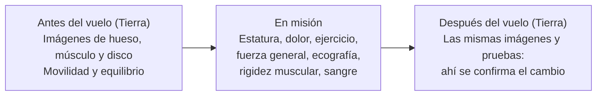

# Herramientas de medición de la columna vertebral en misión espacial

| | |
|---|---|
| **Hackatón** | NASA Space Apps Challenge 2026 — 14 y 15 de noviembre de 2026 |
| **Desafío** | *Create Health Monitoring Software for Astronauts on Space Missions* — [página oficial](https://www.spaceappschallenge.org/2026/challenges/health-monitoring-software/) |
| **Fecha** | 14 de noviembre de 2026 |
| **Para qué es** | Saber, por cada aspecto de la columna, **qué se puede medir durante la misión, con qué y con cuánto respaldo**. |
| **Qué no es** | No propone ideas ni soluciones. Es un relevamiento. |
| **Fuente** | Recursos oficiales del desafío (NASA HRP), otras páginas y reportes de NASA, otras agencias y artículos científicos. Lista completa en la sección 7. |

### Cómo leerlo

- **Sección 1:** el resultado central, en una tabla.
- **Sección 2:** una tabla corta por aspecto.
- **Sección 3:** valores de referencia (unidad, rango, frecuencia).
- **Secciones 4 a 7:** síntesis, lo no verificado y las fuentes.

**Categorías** (se usan igual en todo el documento):

| Categoría | Significado |
|---|---|
| Directa | El instrumento mide la magnitud misma. |
| Indirecta | Mide otra cosa relacionada, de la que se infiere el estado. |
| Estimación | Valor calculado con un modelo o una proyección, sin medirlo en misión. |
| Autorreporte | Lo declara el propio astronauta. |

**Disponibilidad:** *A bordo (rutina)* = se usa habitualmente en la estación · *A bordo (estudio)* = se usó en vuelo solo como investigación · *Solo Tierra* = antes y después del vuelo.

**Fuentes:** `O` = recurso oficial del desafío · `N` = NASA, fuera de los recursos oficiales · `A` = otra agencia u organismo · `P` = artículo científico. Un **asterisco** (`P2*`) indica que **solo leí el resumen**, no el texto completo.

---

## 1. Resultado central: qué se puede medir en misión

**Respaldo** es un criterio mío, no de las fuentes: **Alto** = uso habitual en vuelo o muchos tripulantes · **Medio** = usado en vuelo en estudios de 12 personas o menos · **Bajo** = en misión solo se infiere o se proyecta · **Nulo** = no encontré medición en misión.

| Aspecto | ¿Se mide en misión? | Con qué | Categoría | Respaldo |
|---|---|---|---|---|
| 1. Densidad ósea de las vértebras | **No** | Marcadores en sangre y proyección con tasa promedio | Indirecta / Estimación | Bajo |
| 2. Músculos: tamaño y calidad | **No** (para la espalda) | Rigidez del músculo con sensor de mano | Indirecta | Medio |
| 2. Músculos: fuerza | **Sí**, de cuerpo entero | Prueba de tirón sobre la máquina de fuerza | Directa (cuerpo), Indirecta (espalda) | Medio |
| 3. Discos | **Parcial** | Ecografía: altura y ángulo del disco | Directa, poco precisa | Medio |
| 4. Curvaturas | **No** | Ángulo entre vértebras por ecografía | Indirecta | Bajo |
| 5. Largo y estatura | **Sí** | Fotos con marcas, cinta, marca en la pared | Directa | Alto |
| 6. Movilidad | **No encontrado** | — | — | Nulo |
| 7. Dolor y rigidez | **Sí** | Reporte al médico, cuestionario diario | Autorreporte | Alto |
| 8. Control postural | **No encontrado** (para el tronco) | — | — | Nulo |
| 9. Carga recibida | **Sí** | Registro de las máquinas de ejercicio | Directa (máquina), Estimación (columna) | Alto |
| 10. Marcadores en sangre y orina | **La muestra sí, el resultado no** | Sangre congelada, analizada al volver | Indirecta | Alto (toma) |

> **Dato clave:** en la estación **el ecógrafo es el único equipo de imágenes** (P2*, P3*). No hay equipo para medir densidad ósea en personas: el densitómetro de a bordo es para ratones (A2*).

---

## 2. Detalle por aspecto

### 2.1 Densidad ósea de las vértebras

| Método | Categoría | Disponibilidad | Dato clave y límite | Fuente |
|---|---|---|---|---|
| **DXA** (rayos X de doble energía; da densidad por área) | Directa | Solo Tierra. NASA: 4 veces antes del vuelo, y 5 y 30 días después | Columna: **−0,9 % por mes** (14 tripulantes). No separa hueso compacto de esponjoso | N5, P9* |
| **QCT** (tomografía que da densidad en 3D) | Directa | Solo Tierra (estudios) | Columna: −0,9 %/mes total y −0,7 %/mes en hueso esponjoso | P9*, O5 |
| Resistencia de la vértebra calculada sobre la tomografía | Estimación | Solo Tierra | **−6,1 %** en ~6 meses (17 tripulantes); no se recuperó en hasta 4 años y no acompaña al cambio de DXA | P8* |
| Proyección con la tasa promedio (1 % a 1,5 % por mes) | Estimación | Aplicable en misión | Es un promedio de grupo, no un valor individual | O1 |

### 2.2 Músculos de la espalda y del tronco

| Método | Categoría | Disponibilidad | Dato clave y límite | Fuente |
|---|---|---|---|---|
| **Resonancia (MRI)**: área y proporción de músculo sin grasa | Directa | Solo Tierra (estudios de 6 y 12 personas) | Multífido (músculo profundo que estabiliza la columna): parte magra **80 % → 73 %** | P5, P4*, P6* |
| **Tomografía**: área y densidad del músculo | Directa | Solo Tierra | Área −4,6 % a −8,4 % (17 tripulantes) | P7* |
| **Ecografía** de músculos del tronco | Directa | Solo Tierra. En vuelo se validó solo para piernas | Multífido −6 % a −13 % (5 astronautas) | P16*, P17* |
| **Myoton** (sensor de mano: da un golpecito y mide cómo vibra el tejido) | Indirecta | A bordo (estudio 2018–2023, 12 astronautas). Lo opera un compañero; 4 sesiones por misión | Rigidez del multífido lumbar: **sin cambio estadístico claro**. Solo llega a tejido superficial | P13 |
| **Tirón isométrico** sobre la máquina de fuerza (ARED) | Directa (cuerpo entero), Indirecta (espalda) | A bordo (Standard Measures) | Fuerza máxima de todo el cuerpo. Pérdida promedio de fuerza: **10 % a 12 %** | P14, O4, O2 |

### 2.3 Discos intervertebrales

| Método | Categoría | Disponibilidad | Dato clave y límite | Fuente |
|---|---|---|---|---|
| **Resonancia**: altura y contenido de agua | Directa | Solo Tierra | Tras 6 meses, **sin cambios apreciables** en altura ni en agua | P4*, P5 |
| **Ecografía de columna en vuelo**: altura y ángulo del disco | Directa, poco precisa | A bordo (estudio, 7 astronautas). La hace un astronauta sin experiencia con guía remota; días 30 y 150; menos de 60 min | 92,5 % de imágenes útiles. Coincide con la resonancia en la zona lumbar (r² = 0,83) pero **no en el cuello** (r² = 0,26) | P2*, P3*, N5, N1 |

> **Para no sobreafirmar:** la NASA dejó **inactiva** la preocupación por daño de disco. La vigilancia posterior al vuelo no confirmó más daño atribuible al vuelo, y las hernias parecen ligadas a factores previos (N2). La hidratación del disco no se mide en vuelo.

### 2.4 Curvaturas y alineación

| Método | Categoría | Disponibilidad | Dato clave y límite | Fuente |
|---|---|---|---|---|
| **Resonancia** acostado | Directa | Solo Tierra | Curva lumbar: **41,9° → 37,2°** (−11 %, 6 astronautas) | P5 |
| Ecografía: ángulo entre dos vértebras | Indirecta | A bordo (estudio) | El ángulo sube y después baja durante la misión. No da la curva completa | P3* |
| Video de postura relajada | Indirecta | A bordo (estudio) | Mide ángulos de las articulaciones del cuerpo, no de la columna | N7 |

### 2.5 Largo de la columna y estatura

| Método | Categoría | Disponibilidad | Dato clave y límite | Fuente |
|---|---|---|---|---|
| Marca en la pared del módulo, con ayuda de un compañero | Directa | A bordo (rutina), solo antes de una caminata espacial | Fuera de ese caso, no se medía de rutina (dato de 2018) | P1 |
| **Fotos con marcas en el cuerpo + cinta métrica** | Directa | A bordo (estudio, 9 astronautas); días 15, 80 y antes del regreso | **+2,4 a +2,9 cm** al día 15 y después se estabiliza. Depende mucho de dónde se pone la marca | N7, P15* |
| Regla acoplada al asiento (altura sentado) | Directa | En vuelo (estudio terminado, en el transbordador) | Altura sentado: **+6 %**. De pie: 2 a 4 cm | N5, N3 |
| Medición a la mañana y a la tarde (estudio SkinSuit, ESA) | Directa | A bordo (estudio) | Precisión no encontrada | A1*, P1 |

> **Dato clave:** es el **único aspecto de estructura con medición directa en misión**. La estatura puede aumentar hasta un 3 % (O1).

### 2.6 Movilidad y flexibilidad

| Método | Categoría | Disponibilidad | Dato clave y límite | Fuente |
|---|---|---|---|---|
| **Fluoroscopía** (rayos X en video mientras la persona se mueve) | Directa | Solo Tierra (estudios de 6 y 12 personas) | Flexión y extensión L4–L5: **8,9° → 6,3°** (−30 %). Error de ±1,5° a ±2,2° | P5, P6* |
| Evaluación física con especialista (incluye flexibilidad) | Directa | Solo Tierra; 60 días antes, y 5 a 30 días después | Prueba concreta no encontrada | N5 |

No encontré ninguna medición de movilidad de la columna hecha en misión.

### 2.7 Dolor y rigidez

| Método | Categoría | Disponibilidad | Dato clave y límite | Fuente |
|---|---|---|---|---|
| **Reporte al médico de vuelo** en conferencia médica privada | Autorreporte | A bordo (rutina) | **52 % a 53 %** tuvo dolor de espalda al adaptarse. Leve en el 85 %. Pico el día 2, nada después del día 12 | N4, P11*, N5, N6 |
| **Cuestionario diario** (escala 0 a 10 y ubicación) | Autorreporte | A bordo (estudio, misiones de 15 días, 20 astronautas) | Incidencia 70 %; intensidad media **3 de 10**; cede en 10 días | P12* |
| Rigidez del tejido con Myoton | Indirecta | A bordo (estudio) | Mide rigidez mecánica del músculo, **no la rigidez que siente la persona** | P13 |

La causa del dolor en vuelo sigue sin conocerse (N5).

### 2.8 Control postural

| Método | Categoría | Disponibilidad | Dato clave y límite | Fuente |
|---|---|---|---|---|
| Pruebas de pararse, caminar en línea y levantarse del piso, con sensores de movimiento | Directa | Solo Tierra; antes, y el día 0, 1 y ~9 después | Los déficits duran hasta una semana tras aterrizar | P14 |
| Pruebas de movimiento de cabeza, ojos y cuerpo (CIPHER) | Indirecta | A bordo (estudio) | Detalle no encontrado | O3 |

No encontré medición del control postural del tronco hecha en misión.

### 2.9 Carga recibida: ejercicio y actividad

| Método | Categoría | Disponibilidad | Dato clave y límite | Fuente |
|---|---|---|---|---|
| **Máquinas de ejercicio**: fuerza (ARED), cinta (T2) y bicicleta (CEVIS) | Directa (carga en la máquina) | A bordo (rutina); 6 a 7 días por semana, ~1,5 h por día. Los datos bajan a Tierra | Registran tiempo, pulso, velocidad y carga. ARED llega a 272 kg | O2, P1, N9*, P18* |
| Carga real sobre la columna | Estimación | — | Se calcula con modelos. El sensor de fuerza de ARED no grababa desde 2011 (dato de 2014) | P8*, N8* |
| Sensor de muñeca (actigrafía) | Indirecta | A bordo (Standard Measures); 14 días seguidos cada 60 | Mide movimiento de la muñeca, no carga en la espalda | P14, O4 |
| Remera con sensores Bio-Monitor (CSA) | Indirecta | A bordo (estudio) | Nivel de actividad general | A3* |

Las naves futuras serán más chicas y podrían no llevar cinta (O6, N5).

### 2.10 Marcadores en sangre y orina

| Método | Categoría | Disponibilidad | Dato clave y límite | Fuente |
|---|---|---|---|---|
| **Sangre en vuelo** | Indirecta | A bordo (Standard Measures); primer mes, mitad y último mes | Se congela a −96 °C y se analiza en Tierra: **el resultado no está disponible en misión**. Incluye marcadores de formación de hueso, vitamina D y hormona paratiroidea | P14 |
| Orina de 24 h en vuelo | Indirecta | A bordo (estudios); días 15, 30, 60, 120 y 180 | Calcio y marcador de destrucción de hueso (NTX). Standard Measures hoy no junta orina en vuelo | N10*, P10*, O3, P14 |
| **Analizador portátil i-STAT** (una gota de sangre, menos de 2 min) | Indirecta | A bordo (rutina médica) | Único resultado en el momento: calcio iónico, sodio, potasio, glucosa. No mide recambio de hueso | P19* |

Límite general (lectura mía): estos marcadores reflejan todo el esqueleto, no las vértebras en particular.

---

## 3. Valores de referencia

Para armar datos plausibles. Todos son de **humanos en vuelo** (medidos en misión o antes y después).

| Variable | Unidad | Valor | Momento de medición | Fuente |
|---|---|---|---|---|
| Densidad ósea de columna | % de cambio | −0,9 % por mes (14 tripulantes); −2,2 % en ~6 meses (mediana, 17 tripulantes) | Antes y después | P9*, P8* |
| Estatura | cm | +2,9 (día 15), +2,4 (día 80), +2,5 (antes de volver); máximo 4,7 | En misión | N7, P15* |
| Altura sentado | cm | +2 a +6 | En misión | N5 |
| Dolor de espalda | escala 0–10 | Media 3; pico el día 2; termina antes del día 12 | En misión, diario | P12*, N6 |
| Curva lumbar | grados | 41,9 ± 12,9 → 37,2 ± 11,0 | Antes y después | P5 |
| Movilidad L4–L5 | grados | 8,9 ± 3,1 → 6,3 ± 2,5 | Antes y después | P5 |
| Área del multífido | mm² | 1236 ± 252 → 1158 ± 231 | Antes y después | P5 |
| Rigidez del multífido | N/m | Valor absoluto no extraído; cambio mínimo detectable: 22,8 | En misión, 4 sesiones | P13 |
| Altura de discos del cuello (ecografía) | cm | −0,5 en total | En misión | P3* |
| Ejercicio de fuerza (mediana) | libras | Peso muerto 192; sentadilla 181; elevación de talones 239 | En misión, casi a diario | P20* |
| Ejercicio aeróbico (mediana) | W, mph, min | Bicicleta 137 W; cinta 7 mph; ~27 min por sesión | En misión | P20* |
| Vitamina D en sangre | nmol/L | 75 ± 17 | Antes y en misión | P10* |
| Fuerza general | % de cambio | −10 % a −12 % | Antes y después | O2 |

Precisión: solo la encontré para fluoroscopía (±1,5° a ±2,2°), Myoton (22,8 N/m) y dos marcadores de formación de hueso en sangre (5,5 % y 9 % de variación, P10*). Para el resto, **no encontrada**.

---

## 4. Síntesis

- **Con medición directa en misión:** estatura, dolor (autorreporte), ejercicio realizado y fuerza de cuerpo entero.
- **Con medición parcial y poco precisa:** discos, por ecografía. Sirve para la zona lumbar, no para el cuello, y se probó en 7 personas.
- **Solo de forma indirecta:** estado de los músculos de la espalda (rigidez) y recambio de hueso (sangre, con resultado al volver).
- **Solo como estimación:** densidad ósea de las vértebras y carga real sobre la columna.
- **Sin medición en misión:** curvatura, movilidad y control postural del tronco. Lo que se sabe sale de comparar antes y después del vuelo.
- **Sobre el deterioro silencioso:** la atrofia muscular, la pérdida de curvatura y la pérdida de hueso están bien documentadas, pero **con imágenes hechas en Tierra**, en grupos de 6 a 17 personas. Durante la misión no hay hoy un instrumento que las mida directamente.

---

## 5. Dato y supuesto

| Es dato (medido en humanos en vuelo) | Es supuesto o inferencia |
|---|---|
| Aumento de estatura y su evolución en el tiempo | Que ese aumento se deba a los discos: la resonancia no mostró hinchazón (N5, P1) |
| Frecuencia, intensidad y duración del dolor | La causa del dolor |
| Pérdida de hueso y de músculo entre antes y después | El valor de un astronauta en un día dado de la misión |
| Ejercicio hecho en las máquinas | Cuánta carga llega a la columna |

---

## 6. No verificado o no encontrado

- **Fuentes con asterisco:** solo leí el resumen. PubMed no cargó; usé Europe PMC y los resúmenes de la búsqueda.
- **Frecuencia** de las conferencias médicas privadas y de la prueba de tirón en vuelo: no encontrada.
- **Estado actual** del sensor de fuerza de ARED y de la medición de estatura de rutina: los datos son de 2014 y 2018.
- **Ecografía de columna en CIPHER** (O3): la página dice que se escanea la columna, sin detallar qué se mide.
- **"Autoevaluaciones periódicas de estado físico"** (O2): sin detalle de qué incluyen.
- **Dispositivo ruso** que mide de la nuca a la base lumbar (N5): sin unidad ni precisión.
- **Cifras que no coinciden entre fuentes:** dolor de adaptación 53 % (384/722, N4) y 52 % (382/728, P11*); participantes de ecografía 6 (N1) y 7 (P2*); participantes de altura sentado 23 (N3) y 32 (N5).
- **JAXA y CSA:** no encontré mediciones de columna en vuelo propias de estas agencias.
- **Evidencia en animales y en reposo en cama:** existe (P1, N5), pero no la relevé en detalle por tiempo.

---

## 7. Fuentes

**Recursos oficiales del desafío** (se llega desde la pestaña *Resources*):

- **O1** [Risk of Spaceflight-Induced Bone Changes](https://www.nasa.gov/reference/risk-of-spaceflight-induced-bone-changes/)
- **O2** [Risk of Reduced Cardiorespiratory and Musculoskeletal Fitness](https://www.nasa.gov/reference/risk-of-reduced-cardiorespiratory-and-musculoskeletal-fitness/)
- **O3** [CIPHER](https://www.nasa.gov/reference/cipher/)
- **O4** [Standard Measures](https://www.nasa.gov/reference/standard-measures/)
- **O5** [Astronauts' Spines Under Scrutiny](https://www.nasa.gov/missions/station/astronauts-spines-under-scrutiny/) (estudio *Spinal Health*)
- **O6** [Zero T2](https://www.nasa.gov/reference/zero-t2/)

**NASA, fuera de los recursos oficiales:**

- **N1** [Tarea: Sonographic Astronaut Vertebral Examination](http://humanresearchroadmap.nasa.gov/Tasks/?i=1046)
- **N2** [Preocupación por daño de disco, inactiva](https://humanresearchroadmap.nasa.gov/risks/risk.aspx?i=78)
- **N3** [Tarea: Spinal Elongation](http://humanresearchroadmap.nasa.gov/tasks/?i=624)
- **N4** [Space Adaptation Back Pain: A Retrospective Study](https://ntrs.nasa.gov/citations/20080045877)
- **N5** [NASA 2018 Spine Workshop, informe](https://ntrs.nasa.gov/api/citations/20205004306/downloads/20205004306-TM-20205004306.pdf)
- **N6** [NASA Spine Workshop, diapositivas](https://ntrs.nasa.gov/api/citations/20190001394/downloads/20190001394.pdf)
- **N7** [Body Measures, diapositivas](https://ntrs.nasa.gov/api/citations/20170000413/downloads/20170000413.pdf)
- **N8*** [Portable Load Measurement Device for ARED](https://ntrs.nasa.gov/citations/20140012615)
- **N9*** [Changes in Exercise Data Management](https://ntrs.nasa.gov/citations/20170009916)
- **N10*** [Nutritional Status Assessment SMO](http://hdl.handle.net/2060/20120002897)

**Otras agencias y organismos:**

- **A1*** [ESA, SkinSuit en la misión iriss](https://blogs.esa.int/iriss/2015/08/12/revealing-the-identity-of-skinsuit-man/index.html)
- **A2*** [ISS National Lab, Bone Densitometer](https://issnationallab.org/facilities/bone-densitometer/)
- **A3*** [CSA, Bio-Monitor](https://www.asc-csa.gc.ca/eng/sciences/bio-monitor.asp)

**Artículos científicos:**

- **P1** [Green y Scott 2018, Spinal Health during Unloading and Reloading](https://pmc.ncbi.nlm.nih.gov/articles/PMC5778142/)
- **P2*** [Garcia 2018, ecografía de columna en la estación](https://doi.org/10.1002/jum.14438)
- **P3*** [Harrison 2018, imágenes de columna antes, durante y después](https://doi.org/10.3357/amhp.4878.2018)
- **P4*** [Chang 2016, músculos y discos lumbares](https://pubmed.ncbi.nlm.nih.gov/27779600/)
- **P5** [Bailey 2018, estabilidad de la columna lumbar](https://pmc.ncbi.nlm.nih.gov/articles/PMC6339989/) (resumen y tabla de resultados)
- **P6*** [Bailey 2022, cambios biomecánicos y hernia de disco](https://doi.org/10.1016/j.spinee.2021.07.021)
- **P7*** [Burkhart 2019, músculos paraespinales](https://doi.org/10.1097/brs.0000000000002959)
- **P8*** [Burkhart 2020, resistencia vertebral](https://doi.org/10.1002/jbmr.3881)
- **P9*** [Lang 2004, pérdida de hueso en columna y cadera](https://pubmed.ncbi.nlm.nih.gov/15125798/)
- **P10*** [Smith 2012, ejercicio, nutrición y hueso](https://pubmed.ncbi.nlm.nih.gov/22549960/)
- **P11*** [Kerstman 2012, dolor de espalda de adaptación](https://pubmed.ncbi.nlm.nih.gov/22272509/)
- **P12*** [Pool-Goudzwaard 2015, dolor lumbar en vuelo y en reposo en cama](https://pubmed.ncbi.nlm.nih.gov/26099126/)
- **P13** [Muscle stiffness indicating mission crew health in space, 2024](https://www.nature.com/articles/s41598-024-54759-6) (estudio Myotones)
- **P14** [Spaceflight Standard Measures, 2025](https://www.nature.com/articles/s41526-025-00532-6)
- **P15*** [Young, Kim y Rajulu 2023, cambios antropométricos](https://doi.org/10.1177/00187208211049008)
- **P16*** [Hides 2021, multífido y abdominales](https://doi.org/10.1016/j.spinee.2020.09.006)
- **P17*** [Ecografía autoguiada de músculos de la pierna, 2021](https://www.cell.com/iscience/fulltext/S2589-0042(21)00312-6)
- **P18*** [Ejercicio en vuelo según ESA, 2016](https://pmc.ncbi.nlm.nih.gov/articles/PMC4971634/)
- **P19*** [Tecnología para sistemas médicos de vuelo, 2024](https://www.frontiersin.org/journals/space-technologies/articles/10.3389/frspt.2024.1384457/full)
- **P20*** [Tabla de ejercicio en vuelo, npj Microgravity 2023](https://nature.com/articles/s41526-023-00256-5/tables/1)
