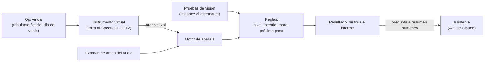

# Arquitectura de Lynceus (nombre provisorio)

> **Estado:** diseño aprobado y prototipo integrado, con historia y referencias
> medidas por el motor. La validación sintética del error (especificación 08) está
> hecha y publicada; su modelo no cumplió los criterios fijados antes de la prueba
> final, así que los rangos siguen saliendo del modelo provisorio
> (`packages/validation/out/quality-validation.md`). El estado de cada entrega se mantiene en
> `producto.md`, sección 14.

| | |
|---|---|
| **Proyecto** | NASA Space Apps Challenge 2026 — *Create Health Monitoring Software for Astronauts on Space Missions* |
| **Fecha** | 15 de noviembre de 2026 |
| **Para qué es** | Conservar el diseño aprobado y sus supuestos como referencia para la construcción. |
| **De dónde sale** | De las decisiones de las rondas 1 y 2 ([decisiones-y-criterios.md](decisiones-y-criterios.md)) y de las investigaciones de `investigaciones/`. Lo que es criterio nuestro y no de la NASA está en la sección 12. |

## 1. Qué es

Lynceus es la primera lectura a bordo del síndrome neuro-ocular del vuelo espacial (SANS). Después de cada examen le dice al astronauta, en menos de un minuto, si la parte de atrás de su ojo cambió respecto de antes del vuelo, cuánto, qué tan seguro es ese resultado y qué corresponde hacer. Deja listo el mismo resultado para el médico en Tierra, que confirma y tiene la última palabra.

## 2. Recorrido del astronauta

| Paso | Qué hace el astronauta | Qué hace el sistema | Real o ficticio |
|---|---|---|---|
| 1. Inicio | Elige su perfil y el día de vuelo | Muestra qué control toca y su historia | Perfil ficticio |
| 2. Pruebas de visión | Agudeza de cerca, grilla de Amsler y cuestionario, un ojo por vez | Calibra la pantalla, toma las pruebas y las puntúa | **Real**: las hace la persona |
| 3. Captura | Pide la tomografía de cada ojo | El instrumento virtual entrega un archivo de examen con el formato del tomógrafo real | Imagen ficticia, formato real |
| 4. Análisis | Espera | Controla la calidad, marca las capas, mide, compara con antes del vuelo, calcula la incertidumbre, asigna el nivel y decide el próximo paso | **Real** |
| 5. Resultado | Lee el resultado de cada ojo | Lo explica con número, rango, nivel y próximo paso; muestra la imagen con lo que midió | **Real** |
| 6. Historia | Mira su evolución | Línea de tiempo por ojo, con umbrales y márgenes | Sesiones anteriores ficticias, calculadas por el mismo motor |
| 7. Conferencia médica | Anota sus preguntas | Arma el informe para el médico y la lista de preguntas | **Real** |

En cualquier paso puede abrir el asistente (sección 8) y la pantalla "Qué se sabe del cerebro" (sección 7).

## 3. Piezas del sistema



| Pieza | Qué hace | Dónde corre |
|---|---|---|
| Ojo virtual | Describe un ojo con parámetros: forma del nervio, grosor de capas, hinchazón y pliegues según el día de vuelo | Navegador |
| Instrumento virtual | Dibuja los cortes como los entrega el tomógrafo (ruido, sombras, fallas de captura) y escribe el archivo `.vol` | Navegador |
| Motor de análisis | Lee el `.vol` y produce las medidas (sección 5) | Navegador, en un hilo aparte |
| Modelo de calidad | Decide si una captura sirve para medir y cuánto error esperar. Es chico y legible: variables y pesos a la vista | Navegador; se entrena con un script |
| Reglas | Nivel, incertidumbre, próximo paso y textos (sección 6) | Navegador |
| Pruebas de visión | Agudeza, Amsler y cuestionario | Navegador |
| Interfaz | Sesión guiada, resultado, historia, informe; inglés y español | Navegador |
| Asistente | Responde preguntas acotadas | Función en Vercel que llama a la API de Claude |
| Validación | Genera ojos de valor conocido, mide el error del motor y entrena el modelo de calidad | Script, en la máquina de desarrollo |

Los datos del astronauta se guardan en el navegador. No hay base de datos ni servidor propio.

## 4. Datos ficticios

- **Aparato real:** el tomógrafo Heidelberg Spectralis OCT2, que está en la estación desde 2017.
- **Formato real:** el archivo `.vol` de ese equipo, con sus cabeceras y campos (`sans-spectralis-datos.md`). El instrumento virtual lo escribe y el motor lo lee.
- **Protocolo de la NASA:** 48 cortes radiales de 15° centrados en el nervio óptico, de 768 × 496 píxeles (unos 5,7 µm por píxel a lo ancho y 3,87 en profundidad). Un examen pesa cerca de 78 MB (cálculo propio a partir del formato).
- **Valores de partida:** los medidos en astronautas antes del vuelo, por ejemplo grosor de la retina junto al nervio de 392 µm (rango 299 a 484).
- **Tripulación:** cuatro astronautas inventados en una misión de 180 días, con controles antes del vuelo y los días 30, 90 y 150.

| Tripulante | Evolución | En qué se basa |
|---|---|---|
| A | Sin cambio: se mantiene dentro del margen normal | El 26 % que no pasa el umbral |
| B | Primer indicio típico: sube de a poco y cruza el umbral cerca del día 90 | Curva promedio de 11 astronautas (+27,6 µm el día 150) |
| C | Nivel clínico, un ojo peor que el otro, con pliegues | Casos del grupo de 31 astronautas |
| D | Caso extremo, sin síntomas | Caso publicado: +120 µm el día 27 y +232 µm el día 126 |

- **Qué se calcula antes y qué en vivo:** las sesiones anteriores se calculan con el mismo motor al compilar y se guardan como resultados. La sesión del día se genera y se analiza en vivo en el navegador.
- **Reproducible:** todo usa números al azar con semilla, así que el mismo examen se puede regenerar para ver la imagen.
- **Marcado:** cada imagen y cada informe dicen que los datos son simulados.

## 5. Motor de análisis

| # | Paso | Método | Respaldo |
|---|---|---|---|
| 1 | Leer el examen | Lector del formato `.vol` | Lectores de código abierto del formato |
| 2 | Controlar la calidad | Índice de calidad del equipo, cortes incompletos, inclinación y descentrado; decide el modelo de calidad | Escala del equipo: 0 a 40 dB; menos de 15 es señal pobre |
| 3 | Marcar dos bordes | Superficie de la retina y membrana de base, por camino de menor costo sobre el gradiente de la imagen | Método de grafos de Chiu y otros (2010) |
| 4 | Ubicar la abertura del nervio | Dos puntos por corte, donde termina la membrana de base; con los 96 puntos se ajusta una elipse | Definición de la NASA |
| 5 | Medir | Grosor de la retina en el anillo de la abertura hasta 250 µm (medida principal) y en tres anillos más; ancho mínimo del anillo neural; ondulación de la membrana de base (pliegues) | Definiciones de la NASA |
| 6 | Comparar | Cada medida contra el examen de antes del vuelo del mismo ojo | Práctica de la NASA |
| 7 | Calcular la incertidumbre | Error del motor medido en la validación, según la calidad de la captura | Propio (sección 10) |
| 8 | Clasificar y decidir | Reglas de la sección 6 | NASA y supuestos nuestros |

Si la captura no alcanza, el sistema pide repetirla hasta tres veces. Si sigue sin alcanzar, dice "no puedo medir este ojo hoy" y lo anota en el informe.

**No mide:** el grosor de la coroides (la NASA lo marca a mano), quistes, aplanamiento del ojo ni cambio de graduación. Lo dice en pantalla.

## 6. Niveles, incertidumbre y próximos pasos

| Nivel | Criterio | Clase de aviso | Próximo paso |
|---|---|---|---|
| Sin cambio detectable | Aumento del grosor hasta 19,4 µm y sin pliegues nuevos | Ninguno | Calendario normal: días 30 y 90, cada 90 días y 30 antes de volver |
| Primer indicio | Aumento mayor a 19,4 µm, o pliegues nuevos | Aviso | Tomografía a las 4 semanas y grilla de Amsler dos veces por semana; va en el informe de rutina |
| Clínicamente preocupante | Aumento de 55 µm o más | Precaución | Avisar al médico sin esperar el informe de rutina; tomografía a las 3 semanas |
| Síntoma agudo de visión | Pérdida brusca de visión, mancha nueva o grilla de Amsler muy deformada | Advertencia | Contactar al médico ya, sin importar la imagen |

- **Los niveles y los umbrales son de la NASA.** Las frecuencias de control y la clase de aviso de cada nivel son supuestos nuestros.
- **Nunca indica medicación.** Si la visión de cerca empeora, sugiere probar los anteojos de mayor graduación que hay a bordo, como estimación.
- **Incertidumbre:** cada número va con su rango. La palabra va pegada al número y sale de la probabilidad de haber pasado el umbral: menos de 10 %, "sin cambio detectable"; 10 a 50 %, "posible"; 50 a 90 %, "probable"; más de 90 %, "muy probable".
- **Etiqueta en cada dato:** medido, estimado o no se puede medir a bordo.
- **Colores:** genéricos por ahora, definidos en un solo archivo de variables para aplicar después el sistema de diseño.

## 7. Pruebas de visión, cerebro y conferencia médica

- **Agudeza de cerca:** a 40 cm, con la figura C de Landolt en ocho orientaciones, después de calibrar el tamaño real de la pantalla con una tarjeta. Si la pantalla no tiene resolución suficiente, informa hasta dónde puede medir.
- **Grilla de Amsler:** a 40 cm, un ojo por vez; el astronauta marca las zonas onduladas, borrosas o faltantes.
- **Cuestionario:** síntomas de visión y de cabeza. El de la NASA no es público, así que la lista es nuestra. Los síntomas de cabeza se registran sin afirmar relación con el síndrome.
- **Qué se sabe del cerebro:** una pantalla fija con lo que se sabe, lo que solo se ve con resonancia antes y después del vuelo y lo que no se puede saber en misión, con sus fuentes.
- **Preparar la conferencia médica:** el informe para el médico (medidas, cambios, calidad, incertidumbre, nivel, pruebas y síntomas) y las preguntas que anotó el astronauta. Se puede descargar.

## 8. Asistente

- **Modelo:** Claude Haiku 5.5 (`claude-haiku-5-5`), esfuerzo medio, con la clave administrada por el responsable del proyecto.
- **Qué hace:** explica el resultado y los términos, responde sobre el síndrome con una base fija de datos citados y ayuda a armar preguntas para el médico.
- **Qué no hace:** diagnosticar, cambiar el nivel que calculó el motor, indicar medicación ni atender pedidos ajenos, como escribir código.

| Barrera | Cómo funciona |
|---|---|
| Instrucciones fijas | Alcance, reglas y base de datos van en el servidor; el visitante no las puede cambiar |
| Respuesta con formato fijo | El modelo devuelve si la pregunta está dentro del alcance, la respuesta y las fuentes |
| Negativa fija | Si está fuera del alcance, se muestra un texto nuestro, no el del modelo |
| Revisión de la respuesta | Si trae código o no cita la base, se reemplaza por la negativa |
| Límites | Pregunta de hasta 500 caracteres, respuesta corta y tope de pedidos por visitante |
| Tope de gasto | Límite mensual en la consola de Anthropic; lo configura el responsable del proyecto |

- **La clave** va en Vercel y en un archivo local que no se sube al repositorio. El asistente de desarrollo no la lee ni la imprime.
- **Sin conexión**, el análisis funciona igual; solo falta el asistente.
- **Excepción a "los datos no salen del dispositivo":** al preguntar, se envían a la API la pregunta y un resumen numérico del resultado, sin nombre. Se avisa en pantalla antes del primer uso.

## 9. Tecnología y publicación

| Tema | Decisión |
|---|---|
| Lenguaje | TypeScript en todo el proyecto |
| Herramientas | Node 22 y pnpm (ya instalados), Vite, React y Vitest |
| Dependencias | Pocas, instaladas dentro del proyecto, con versiones publicadas hace más de 7 días. Nada global |
| Estilos | CSS propio con variables; sin librería de componentes |
| Gráficos | Propios, sin librería |
| Publicación | Vercel, plan gratuito: sitio estático más una función para el asistente |
| Secretos | `.gitignore` desde el primer commit y revisión automática de claves antes de cada commit |

```
apps/web/                      interfaz y función del asistente
packages/core/                 formato .vol, ojo e instrumento virtuales, motor, reglas, pruebas de visión, textos
packages/validation/           datos ficticios, validación del motor y modelo de calidad
docs/                          documentación en español e inglés
monitoreo-salud-astronautas/   documentos de trabajo e investigaciones
```

El nombre del producto va en un solo lugar del código, para poder cambiarlo.

## 10. Pruebas y validación

- **Pruebas automáticas** de cada pieza: lectura y escritura del `.vol`, geometría, marcado de capas, medidas, reglas y cálculo de la agudeza.
- **Validación del motor:** cientos de ojos de valor conocido pasan por el motor. Se mide el error en micrómetros y cuántas veces acierta o falla cada umbral, según la calidad de la captura.
- **Uso de ese error:** es el rango que ve el astronauta, y se publica en la aplicación y en el repositorio.
- **Se declara** como precisión sobre datos ficticios, no validada con personas.

## 11. Criterios que se suman

Aceptados en la ronda 2: todo número se puede rastrear hasta la imagen y la fuente; la misma entrada da el mismo resultado; si la imagen no alcanza, dice "no puedo medir"; los datos de salud no salen del dispositivo (con la excepción de la sección 8); letra y contraste según la norma de la NASA; todos los supuestos en un solo lugar.

## 12. Supuestos nuestros

El registro vigente está en [docs/assumptions.md](../docs/assumptions.md), en
español e inglés. A01–A20 conservan la numeración anterior para que sigan sirviendo
las referencias de las especificaciones y del código a esta sección.

Los nuevos supuestos se agregan allí. El registro distingue umbrales publicados,
decisiones propias, modelo provisorio activo y candidato experimental no activado,
y enlaza los detalles técnicos de implementación.

## 13. Plan de construcción

| Etapa | Qué queda funcionando |
|---|---|
| A | Proyecto armado; formato `.vol`; ojo e instrumento virtuales |
| B | Motor de análisis con sus pruebas |
| C | Validación y modelo de calidad |
| D | Interfaz: sesión guiada de punta a punta (**punto de control 2**) |
| E | Pruebas de visión, historia, informe y pantalla del cerebro |
| F | Asistente |
| G | Documentación en español e inglés, publicación y entrega (**punto de control 3**) |

- **Quién construye:** una sola sesión de Claude Code (Opus 5.5, xhigh). Falta definir con el responsable del proyecto si corre sin pedidos de permiso o con una lista de comandos permitidos (instalar dependencias del proyecto, compilar, probar y hacer commits). El asistente de esta sesión especifica, revisa cada etapa, corre las pruebas y escribe la documentación.
- **Dónde:** en una rama aparte, que se une a `master` al cerrar cada etapa.

## 14. Pendientes del responsable del proyecto

1. Aprobar este documento o marcar qué cambiar.
2. Confirmar la excepción de privacidad del asistente (sección 8).
3. En la etapa F: cargar la clave en el archivo local y en Vercel, y poner el tope de gasto.
4. En la etapa G: crear el repositorio y el proyecto en Vercel.
5. Crear el equipo en la web de Space Apps.
